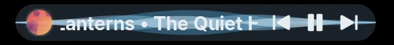
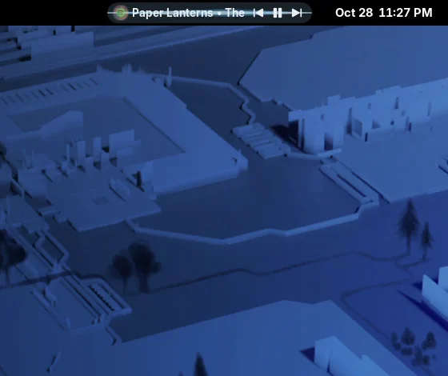
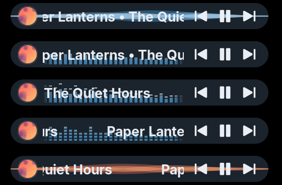
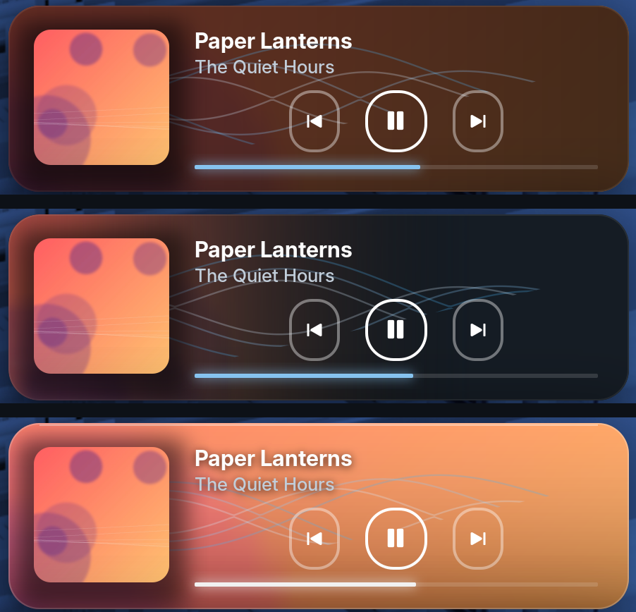

# Better Media Controller

A small media controller for the GNOME top panel. A rounded pill shows the
current track with previous, play/pause and next buttons and a soft animated
wave behind them. Click it and a stack of slim cards opens, one per player,
each with its cover, title, artist, controls and a progress bar. It's meant as
a lighter replacement for Advanced Media Controller.



## Features

- **Follows what's playing.** The pill shows the player that is playing. If
  several are, it picks the one you started last; if none is, the one you
  paused last. With nothing to show, it hides.
- **One card per player.** The popup lists up to four players. Press play on
  any card and that player takes over the pill, with its card moving to the
  top.
- **A pill effect to your taste.** A wave across the whole pill, or an
  equalizer behind the track name: plain bars, bars with falling peaks, or
  stacked blocks. The color can be light blue, taken from the song cover, or
  one you pick. Everything stays still while paused.
- **App logo and cover.** The pill icon can show the app's logo, the song
  cover, or alternate between the two.
- **Popup backgrounds.** Each card can sit on a blurred copy of the cover, a
  cover bleed, or glass.
- **Choose your players.** Show all players, only the ones you tick, or all
  except the ones you tick. Every tab of a browser counts as one player.
- **Replaces GNOME's media card.** GNOME's own player in the notification list
  is hidden while the extension is on (you can turn that off).
- **Hide when paused.** Optionally, the pill shrinks away after playback has
  been paused for a while and comes back when it resumes.



The pill effects, from top to bottom: wave, bars, bars with peaks, stacked
blocks, and the wave in the cover's color.



The popup backgrounds, from top to bottom: blurred cover, cover bleed, glass.



## Requirements

GNOME Shell 50.

If Advanced Media Controller is installed, turn it off first.

## Install

1. Download `better-media-controller@idogr.shell-extension.zip` from the
   [latest release](https://github.com/idogrf/better-media-controller/releases/latest).
2. Install it:

   ```bash
   gnome-extensions install --force ~/Downloads/better-media-controller@idogr.shell-extension.zip
   ```

3. Log out and log back in. GNOME only picks up newly installed extensions at
   login.
4. Turn it on in the **Extensions** app, or with:

   ```bash
   gnome-extensions enable better-media-controller@idogr
   ```

To update, repeat steps 1 to 3 with the new release.

## Settings

Open the settings from the gear icon in the **Extensions** app, or with
`gnome-extensions prefs better-media-controller@idogr`. Every change applies
right away.

- **Panel:** where the pill sits in the panel and the order of its parts, what
  the icon shows and how often it switches, the track label (title, artist or
  both, width, scrolling, font, size and color), and hiding the pill when
  paused.
- **Popup:** the card background, blur strength, corner radius and width.
- **Waves:** whether the pill and the popup show a wave, the pill's effect,
  and the wave color, intensity and speed.
- **Players:** hiding GNOME's own media card, and which players to show. A
  player appears in the list once it has played something.

## Uninstall

```bash
gnome-extensions uninstall better-media-controller@idogr
dconf reset -f /org/gnome/shell/extensions/better-media-controller/
rm -r ~/.cache/better-media-controller
```

The second line removes its saved settings, the third its cache of
downloaded covers.

## Build from source

```bash
git clone https://github.com/idogrf/better-media-controller.git
cd better-media-controller
sh pack.sh
```

This writes `dist/better-media-controller@idogr.shell-extension.zip`. Install
it as in step 2 above.

## License

GPL-2.0-or-later. See [LICENSE](LICENSE).
